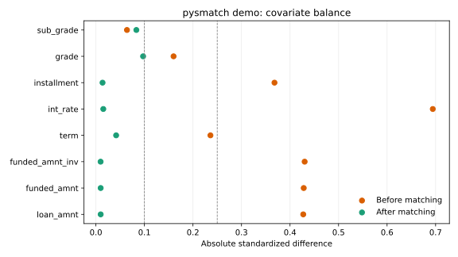

# `pysmatch`

[](https://badge.fury.io/py/pysmatch)
[](https://pepy.tech/project/pysmatch)
[](https://github.com/miaohancheng/pysmatch/actions/workflows/python-publish.yml)
[](https://miaohancheng.com/pysmatch/)
[](LICENSE)
[](https://codecov.io/github/miaohancheng/pysmatch)

**Propensity Score Matching (PSM) in Python for reproducible observational studies.**

Estimate propensity scores, match treatment and control units, and inspect covariate balance in a single workflow. The package supports logistic regression, KNN, CatBoost, caliper matching, exhaustive matching, and balance diagnostics.

`pysmatch` is an improved and extended version of [`pymatch`](https://github.com/benmiroglio/pymatch), with modernized modeling, modularized matching utilities, and better support for reproducible workflows.

### Multilingual

[English](https://github.com/miaohancheng/pysmatch/blob/main/README.md) | [中文](https://github.com/miaohancheng/pysmatch/blob/main/README_CHINESE.md)

[Documentation](https://miaohancheng.com/pysmatch/) · [API reference](https://miaohancheng.com/pysmatch/api.html) · [Issues](https://github.com/miaohancheng/pysmatch/issues) · [Citation](CITATION.cff)



### Highlights

- Multiple score models: Logistic Regression, KNN, CatBoost
- Flexible balancing: oversampling and undersampling (`balance_strategy`)
- Standard and exhaustive matching workflows
- Balance diagnostics for categorical and continuous covariates
- Optional Optuna tuning for automated model search

## Installation

Install from PyPI:

```bash
pip install pysmatch
```

Install optional extras:

```bash
pip install "pysmatch[tree]"   # CatBoost support
pip install "pysmatch[tune]"   # Optuna support
pip install "pysmatch[viz]"    # plotting and balance visualizations
pip install "pysmatch[all]"    # all optional dependencies
pip install "pysmatch[dev]"    # test, lint, and package tooling
```

Install from source:

```bash
git clone https://github.com/miaohancheng/pysmatch.git
cd pysmatch
pip install -e ".[all]"
```

## Quickstart

This minimal example runs the full core path with the demo dataset shipped in the package.

```python
import warnings
warnings.filterwarnings("ignore")

import numpy as np
from pysmatch import Matcher, load_demo

np.random.seed(42)
data = load_demo()

test = data[data.loan_status == "Default"].copy()
control = data[data.loan_status == "Fully Paid"].copy()

matcher = Matcher(
    test=test,
    control=control,
    yvar="is_default",
    exclude=["loan_status"],
    random_state=42,
)

matcher.fit_scores(
    balance=True,
    balance_strategy="over",
    nmodels=10,
    model_type="linear",
    n_jobs=2,
)
matcher.predict_scores()
matcher.match(method="min", nmatches=1, threshold=0.001, replacement=False)

print(matcher.matched_data.head())
print(matcher.balance_report())
```

The demo data is shipped with the package, so this example also works after a clean `pip install pysmatch`.

## End-to-End Workflow

### Data Preparation

Use domain-relevant covariates and avoid leaking post-treatment variables into matching features.

```python
import pandas as pd

fields = [
    "loan_amnt",
    "funded_amnt",
    "funded_amnt_inv",
    "term",
    "int_rate",
    "installment",
    "grade",
    "sub_grade",
    "loan_status",
]

raw = pd.read_csv("misc/loan.csv", usecols=fields)
test = raw[raw.loan_status == "Default"].copy()
control = raw[raw.loan_status == "Fully Paid"].copy()
```

### Initialize Matcher

```python
from pysmatch import Matcher

matcher = Matcher(
    test=test,
    control=control,
    yvar="is_default",
    exclude=["loan_status"],
)

print("xvars:", matcher.xvars)
print("test/control:", matcher.testn, matcher.controln)
```

### Fit Propensity Score Models

`fit_scores` supports three model types:

- `linear` (logistic regression)
- `knn`
- `tree` (CatBoost, requires `pysmatch[tree]`)

```python
matcher.fit_scores(
    balance=True,
    balance_strategy="over",   # "over" or "under"
    nmodels=10,
    model_type="linear",
    max_iter=200,
    n_jobs=2,
)

print("models:", len(matcher.models))
print("avg validation accuracy:", sum(matcher.model_accuracy) / len(matcher.model_accuracy))
```

Optuna path (single tuned model):

```python
# matcher.fit_scores(
#     balance=True,
#     model_type="tree",
#     use_optuna=True,
#     n_trials=20,
# )
```

### Predict and Plot Scores

```python
matcher.predict_scores()
matcher.plot_scores()
```

`matcher.data` now contains a `scores` column.

### Tune Threshold

```python
import numpy as np

matcher.tune_threshold(
    method="min",
    nmatches=1,
    rng=np.arange(0.0001, 0.0051, 0.0005),
)
```

Choose a threshold that balances quality and retained sample size.

### Run Matching

Standard matching:

```python
matcher.match(
    method="min",
    nmatches=1,
    threshold=0.001,
    replacement=False,
    exhaustive_matching=False,
)
matcher.plot_matched_scores()
```

Exhaustive matching:

```python
matcher.match(
    threshold=0.001,
    nmatches=1,
    exhaustive_matching=True,
)
```

### Review Matched Data and Weights

```python
print(matcher.matched_data.head())
print(matcher.record_frequency().head())
matcher.assign_weight_vector()
print(matcher.matched_data[["record_id", "match_id", "weight"]].head())
```

## Matching Strategies

### Standard vs Exhaustive Matching

- **Standard (`exhaustive_matching=False`)**: uses nearest-neighbor style control selection with configurable method/replacement behavior.
- **Exhaustive (`exhaustive_matching=True`)**: prioritizes wider control utilization while still respecting threshold constraints.

### Key Parameters

- `threshold`: max allowed score distance
- `nmatches`: controls per treated unit
- `replacement`: whether a control can be reused
- `method`: `"min"` (closest), `"random"` (random within threshold), or
  `"optimal"` (minimum-cost one-to-one assignment)
- `distance`: `"probability"` or `"logit"` propensity distance; the latter is
  the usual logit-scale caliper
- `exact`: columns that must have identical values within each matched pair

### Practical Guidance

- Start with `nmatches=1`, `replacement=False`, and a moderate threshold.
- If retention is too low, loosen `threshold` gradually.
- If balance is weak after matching, tighten threshold or change model/balance strategy.
- For severe class imbalance, test `balance_strategy="under"` as sensitivity analysis.

To compare matching performance across releases, run the separate benchmark
harness: `python benchmarks/benchmark_matching.py --rows 10000`.

Examples:

```python
# Logit propensity caliper
matcher.match(threshold=0.2, distance="logit")

# Exact matching within site, then nearest propensity score
matcher.match(threshold=0.05, exact=["site"])

# Minimum-cost one-to-one assignment (moderate data sizes)
matcher.match(method="optimal", threshold=0.05)
```

## Evaluation

After matching, evaluate covariate balance before causal analysis.

The table-based `balance_report()` works with the core install. Plotting
helpers such as `compare_continuous()` and `plot_scores()` require
`pip install "pysmatch[viz]"`.

### Categorical Covariates

```python
cat_table = matcher.compare_categorical(return_table=True, plot_result=True)
print(cat_table)
```

Interpretation:

- check before/after p-value shifts
- look for reduced proportional differences after matching

### Continuous Covariates

```python
cont_table = matcher.compare_continuous(return_table=True, plot_result=True)
print(cont_table)
```

Interpretation:

- compare KS statistics and grouped permutation test p-values
- monitor standardized mean/median differences pre vs post matching

For a compact report that uses standardized mean differences (SMD) and
category-proportion differences as the primary balance measures:

```python
balance = matcher.balance_report()
print(balance[["variable", "abs_smd_before", "abs_smd_after"]])
```

As a rule of thumb, inspect absolute SMD values together with retention and
the research design; statistical significance alone is not a balance target.

Check common support before interpreting an effect:

```python
print(matcher.overlap_report())
```

The other structured diagnostics are available without parsing plots:

```python
print(matcher.positivity_report())
print(matcher.effective_sample_size())
print(matcher.score_report())       # accuracy, AUC, and Brier score
print(matcher.calibration_report())
matcher.plot_love(threshold=0.1)
matcher.plot_overlap(scope="after")
matcher.plot_calibration()
```

### Estimate a Matched Effect

After checking overlap and balance, estimate a descriptive matched-sample
contrast with a reproducible bootstrap interval:

```python
effect = matcher.estimate_effect(
    outcome="outcome",
    estimand="ATT",       # "ATT", "ATC", or "ATE"
    bootstrap=1000,
    random_state=42,
)
print(effect["estimate"], effect["ci_lower"], effect["ci_upper"])
```

This estimate still relies on the study's identification assumptions and does
not remove unmeasured confounding. Report the estimand, retention, balance, and
sample definition together.

### Single Variable Proportion Test

```python
print(matcher.prop_test("grade"))
```

## Troubleshooting

### `ValueError: numpy.dtype size changed`

This is usually a NumPy/Pandas binary compatibility issue.

```bash
pip install --upgrade --force-reinstall "numpy>=1.26.4" "pandas>=2.1.4"
```

Restart your Python kernel/session after reinstalling.

### `Scores column not found`

Run `predict_scores()` before `match()`.

```python
matcher.fit_scores(...)
matcher.predict_scores()
matcher.match(...)
```

### `FileNotFoundError` for dataset path

The built-in demo is available without a repository checkout:

```python
from pysmatch import load_demo
data = load_demo()
```

### No matches found

Usually threshold is too strict or groups are weakly overlapping.

- increase `threshold`
- try a different `model_type`
- inspect score distributions with `plot_scores()`

### Jupyter kernel issues in notebooks

If your notebook kernel name is unavailable, switch to an existing kernel (`python3`) and rerun cells.

## FAQ

### When should I use `linear` vs `tree` vs `knn`?

- Start with `linear` for strong baseline interpretability.
- Use `tree` for nonlinear relationships and mixed feature types.
- Use `knn` as a local-structure baseline and compare sensitivity.

### Is high model accuracy always better for matching?

Not necessarily. Very high separability may indicate weak overlap, which can reduce matchability. Balance diagnostics matter more than raw classifier accuracy.

### Should I use over- or under-sampling?

- `over`: usually keeps more majority information; good default.
- `under`: faster/smaller training sets; useful for sensitivity checks.

### How do I make runs reproducible?

- pass a fixed `random_state` to `Matcher` and matching functions
- keep fixed package versions
- record model/matching parameters in experiment logs

### Additional resources

- Sekhon, J. S. (2011), *Multivariate and propensity score matching software with automated balance optimization: The Matching package for R*. Journal of Statistical Software, 42(7), 1-52. [Link](https://www.jstatsoft.org/article/view/v042i07)
- Rosenbaum, P. R., & Rubin, D. B. (1983), *The central role of the propensity score in observational studies for causal effects*. Biometrika, 70(1), 41-55. [Link](https://stat.cmu.edu/~ryantibs/journalclub/rosenbaum_1983.pdf)

### Contributing

Contributions are welcome. Please open an issue or pull request in this repository.

### Cite

See `CITATION.cff` in the repository for citation metadata. Please also cite the
methodological references below when you publish results.

### License

`pysmatch` is released under the MIT License.
